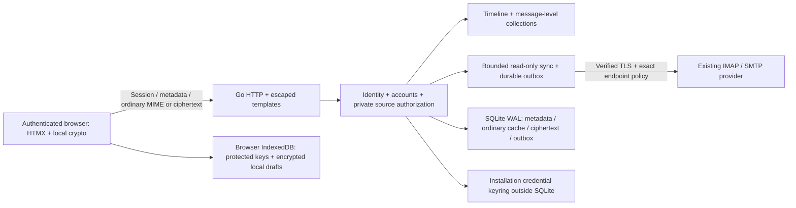

# Architecture

Mailspace is a modular Go monolith with html/template, HTMX, Tailwind and small browser-only crypto modules. One authenticated Space dialog lives at `/`; original email-thread context is an addressable query view. Legacy Classic/Conversation/Calendar pages and the unauthenticated demo are removed. See ADR-0019.

These are implemented boundaries. PostgreSQL, team source ACLs, JEV/provider adapters, Drive and content/semantic indexing remain separate roadmap modules, not runtime dependencies.

## Modules

| Package/area | Responsibility and boundary |
|---|---|
| identity | Local users/Argon2id, opaque digested sessions, CSRF context, profile/timezone, organization membership, transactional operator recovery/revocation |
| accounts / credential vault | Owned IMAP/SMTP configuration, verified setup and encrypted provider credentials under an installation keyring |
| mailnet | Exact host:port allowlists, public/private endpoint policy, DNS pinning, mandatory verified TLS, bounded IMAP/SMTP operations |
| mailsync | Cached original MIME/metadata, connection revision and UIDVALIDITY/UID authorization, bounded read-only synchronization |
| outbox | Durable nonces, one SMTP attempt, accepted/rejected/unknown outcome and independent Sent-copy certainty; original reply headers |
| timeline | Current authorized IMAP/outbox references, conservative exact-copy identity, unified message records and original reference-thread projection |
| collections | Private Space/label definitions and individual-message many-to-many membership; manual revisions and optimistic description edits |
| httpapi / webui | Session-scoped routes, escaped full pages/HTMX fragments, metadata-only filters, dialog runs, thread context, inline reply and native fallbacks |
| web/crypto | Local protected-key vault/trust, signing/encryption/decryption, encrypted local drafts/attachments, isolated HTML preview |
| privacy | Internal provenance/export policy; no silent client-decrypted export to a future module |

The synthetic dev sandbox runs the same product against loopback-only TLS fixtures and disposable local users. Production never provisions a demo login or sample mail automatically. Internal contracts may evolve through reviewed contributions; no public plugin loader/SDK or arbitrary scripts.

## Sources and Spaces

A typed source is either current owned IMAP (account, connection revision, exact mailbox, UIDVALIDITY, UID) or outbox (account, revision, outgoing id). Logical identity hashes the account/config namespace, Message-ID and original MIME content hash; missing IDs use a physical fallback. Exact byte copies may collapse; conflicting IDs or transit-modified copies are not guessed equal. Sources are authorized again when read, assigned or replied to. Retaining an old membership never grants access to a reconfigured mailbox.

A Space is a relevance brief and a set of individual message references, not a provider folder, account or original email thread. Membership is many-to-many and does not copy/move remote mail. Private labels follow the same source boundary. Removing a collection deletes only its definition/assignments. Manual operations have revisions for a future decision gate; no provider/model is active now.

The dialog's compact adjacent-author groups and own-message alignment are presentation only. They never combine send targets, memberships or ACLs. Original thread preview follows only unambiguous cached Message-ID/References within the same current account, across folders/outbox. Cycles terminate; equal subjects do not join messages. It resolves up to 100 cached entries around the selected anchor, not full remote history. Switching Space/person/label leaves that context; Reply selects one original source. Server-derived From and References/In-Reply-To are preserved regardless of the Space.

The main source feed is bounded to 1,000 consolidated cached entries; outbox enumeration is bounded per account. Search is metadata substring filtering, not full-text/semantic indexing. Space/label assignment controls load on demand instead of rendering every possible assignment form for every cached message. Native URLs/forms remain functional without HTMX; browser cryptography deliberately requires JS.

## Mail transport and certainty

Synchronization uses verified TLS and read-only EXAMINE/BODY.PEEK, durable checkpoints/current connection generations and explicit MIME/cache budgets. It does not implement a full archive mirror, remote flag/delete/archive operations, native IDLE/CONDSTORE/QRESYNC guarantees or provider OAuth. Exact current limits are in MAIL_SYNC.md. Original MIME octets remain available for cryptographic parsing; HTML is not a source of reconstructed signed bytes.

Ordinary user-authored replies require explicit plaintext consent. Encryption removes the body field name, disables HTMX for that form and signs/encrypts locally; an allowlisted request carries metadata and ciphertext only. An encrypted original cannot silently downgrade. Unlocking a local key and sending are separate actions; missing/changed/untrusted recipients fail closed.

The outbox commits before dispatch, uses nonce uniqueness and a prepared→sending CAS, and never automatically resends ambiguous/interrupted attempts. SMTP acceptance is not delivery; IMAP Sent APPEND has independent certainty. The browser and native fallbacks lead to an honest recorded outcome. Bcc is envelope-only for recipients but remains sensitive owner-scoped outbox metadata.

## Crypto and hostile mail

Private OpenPGP keys remain protected in the user's browser vault; passphrases and unlocked objects stay in memory and lock on inactivity/hidden page/session lifecycle. Browser vaults/drafts are separate per user/origin/device and require protected exports. The backend stores ordinary mail and OpenPGP ciphertext; it never receives decrypted client material or private keys. Subject/addressing metadata remains visible to mail transport.

Native text/plain is preferred. HTML-only converts to inert text; explicit HTML preview uses the reviewed DOMPurify boundary and an empty-sandbox iframe srcdoc, restrictive CSP, fixed-style hash and no remote resources/navigation. Closing/locking removes preview/source material. Generic templates never cast mail to trusted HTML. See CLIENT_CRYPTO.md and ADR-0015 for the narrow renderer exception.

No optional module may silently consume client-decrypted bodies, index them, place them in a trace or call an AI/webhook. Any future explicit per-fragment export needs its own reviewed consent/provenance boundary. Global opt-in does not authorize hidden decrypted-content egress.

## Persistence, operations and trust

SQLite WAL with foreign keys and versioned transactional migrations is the current storage. DB/cache/outbox/collection metadata are owner-scoped. Ordinary cached mail is sensitive and is not whole-database encrypted. Provider credentials use a separate installation keyring; this protects a DB-only theft, not compromise of the running server or a backup containing both DB and keyring.

Run one app process per SQLite installation. Non-root Compose persists the entire data directory in a named volume, keeps the image read-only, binds localhost and relies on the operator's HTTPS reverse proxy. Explicit public origin, Secure HttpOnly SameSite cookies, exact Origin/CSRF checks and no private browser history snapshots/cache remain enforced. The liveness endpoint does not prove mail delivery.

Offline backup/restore keeps database, possible WAL/SHM and matching credential keyring together. Restore into a fresh volume and revoke restored sessions. Downgrade requires the old image plus its matching complete snapshot; older binaries refuse newer schemas. Operator password recovery changes only the app password and revokes target sessions atomically, never provider/OpenPGP passwords. Full procedures: SERVER_SETUP.md.

Organization membership currently does not grant private mail access. Shared sources, thread sharing and send-as ACLs require a separate implementation and two-user denial tests before any team feature is advertised. The remaining compatibility, security and 1.0 release gates are recorded in RELEASE_READINESS.md.
